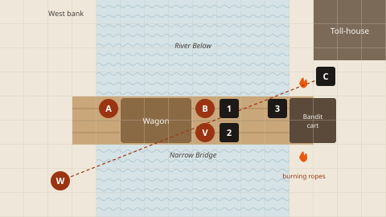

:::quote
Every round's a puzzle with a clock on it, and you get to see all the pieces before you move.
:::

In most games, tactics means finding a bonus: flank for +2, high ground for +1. Zi'Dara doesn't work like that. Before anyone moves, the GM puts everything that's coming this round on the table: what it's doing, who it's aimed at, and how hard. You can see the whole problem. The trouble is, you've got more problems than actions.

So in Zi'Dara, tactics comes down to choices, and everyone's got one action a round to make them with. What do you answer, and who answers it? Who Defends, who intercepts, and what do you let ride? What do you ignore completely, because the stake matters more than the spear? Whose roll do you put your action into? And where do you stand when the round ends?

This chapter's about those choices. The rules themselves are in [The Core](#the-core), [Conflict](#conflict) and [The Archetypes](#archetypes), apart from movement and range, which live here. The rest of the chapter is about using them well, whether you're on a grid or playing it in your head.

## The Five Choices of a Round {#s-five-choices}

Everyone gets [one action a round](#s-actions), and your stride, a few words and dropping something are free. With that, the crew makes five choices together every round.

1.  **Answer.** Which telegraphs do you stop? An answer can stop anything, whether it's a blow, an alarm or a slammed door, but it costs an action, and if it fails, you've walked straight into it.
2.  **Defend, intercept, or let it ride.** Whatever nobody answers lands at the end of the round, and each die of defence stops one telegraph. Who Defends, who steps in front of a friend, and who's got the defence to let it ride? Bram's d8 Defend will usually stop one d4, but if three are coming at him and he lets them ride, at least two get through.
3.  **Press.** What do you do with the rest? Stakes, clocks, weak points, the thing the scene's actually about.
4.  **Team up and shape.** Whose roll do you put your action into? Every action in a roll brings its steps and a split, so two of you on one thing is a much bigger roll than either of you alone. Then do you want one big die, several intents, or advantage?
5.  **Stand.** Where are you when the round ends? Who can reach you, who can you reach, and which friends are within your stride if you need to intercept for them?

Make all five on purpose and it's a good round. The great rounds are the ones where one action solves two problems.

If nothing's worth your action this round, **hold it**: do nothing apart from your stride, and you've got two actions next round. There are other ways to an [extra action](#s-extra-actions) too: spend 1 Resolve, come out of hiding, cash in your Confidence when it's fired up at d12, or use a trait like *Second Wind*. An extra action can be its own roll, or go into the same roll as a combo.

## Movement and Range {#s-movement}

:::quote
You play Zi'Dara on a grid first, where 1 square is 1 unit, about five feet.
:::

-   **Stride is free.** Every character has a base **stride of 3 units**. Every round you can move your stride without spending an action, whether that's before, between or after your actions.
-   **Move action.** Spend your action to go further. Roll whatever makes you fast here, plus the action. That's usually your Move set action, like Vesk's Title, *run the rooftops* and her grappling line. The number you roll is how many extra units you move. Split it into several dice and they add together. Movement's the one roll in Zi'Dara where dice add.
-   **Diagonals count as one.** It keeps things quick.
-   **Difficult ground**, like deep snow, a slick floor or a crowd, costs 2 units a square. *Sure-Footed* ignores it.
-   **Your sheet can change your stride.** *Light on my Feet* adds 2 units, and so does the Stride Boon. A Stride Burden takes 2 away, and a *Heavy* Catch on something you've attuned takes 1, to a minimum of 0. A [Teleporter](#a-teleporter)'s stride can be a teleport of up to 10 units.
-   **Getting something out of your bag** takes your action, but putting it away is free. See [What you carry](#s-carrying).

:::rule
**No reactions, no opportunity attacks.** You can walk right past a guard and nothing lashes out at you for moving. Threats control space with their *telegraphs*, like *cut off the way to the door* or *grab whoever runs*, so you always know what moving will cost before you move. Moving doesn't get you out of a telegraph aimed at you, though. That one lands wherever you end up, and diving behind cover once it's aimed is a way of answering it, so roll for it. Only a telegraph aimed at a place, like a fire or a falling chandelier, can be walked out of.
:::

### Reach and range {#reach-and-range}

How far a bow, a thrown knife or a spell reaches is the story's call. The bands are a guide, so don't go getting a ruler out.

| Band | Grid | What reaches it |
| --- | --- | --- |
| **Close** | Next to you (1 unit) | Fists, blades, a whisper, a hand on the shoulder. |
| **Reach** | 2 units | Spears, polearms, whips: anything with *Reach*. |
| **Near** | Across a room, or down a street | Thrown and Ranged weapons: knives, slings, shortbows, pistols. Most magic. A shout. |
| **Far** | Across a town square, or a field | Longbows and crossbows: anything *Long*. Magic that goes beyond. |
| **Beyond** | Further | The story decides: a siege engine, a sniper's rifle, a working that spans the city. |

**Line of sight** comes from the story. If something solid's in the way, you can't hit through it, and neither can they. That's what cover is. It decides what's possible, and it doesn't add steps. Stand behind a wall and the archer on the roof has to telegraph at someone else, or come down.

:::example[Movement at the table]
Vesk has *Light on my Feet*, so her stride is 3 + 2 = 5. In one round she moves those 5 units for free, then spends her action to Move across the rooftops. Her Move is her first Title, *run the rooftops* and her grappling line, plus the action, so she's on 4 steps, a d8. She rolls a 6, and that's 11 units in total.

Bram's stride is 3. He moves 3 units for free, then spends his action on a Move. Nothing on his sheet makes him fast, not even a Title, so it's the action on its own: 1 step, a d2. He rolls a 2, its top face, so he gets 1 Aura back, and that's 5 units in total. He's no runner, and his sheet says so.
:::

## Weapons and What They Let You Do {#s-weapons-tactics}

A plain weapon is just what it is. It counts as a line whenever it fits, so it's a step on your roll, and it lets you do what that weapon does: a sword cuts, and a spear keeps them back. An attuned weapon counts through its own permissions instead. Wren's longbow is *shoot a longbow* and *hit anything I can see*, and the bow doesn't count again on top.

Weapons also come with **properties**, free with the weapon. They're the things a weapon lets you do that bare hands can't. The full list is in [Weapon properties](#s-weapon-props). At the table they sort into four jobs:

-   **Controlling distance**: *Reach, Thrown, Ranged, Long.* You're hitting them from where they can't hit back. A spear holds a doorway, and a longbow holds a whole street.
-   **Getting through**: *Piercing, Breaker.* A crossbow bolt doesn't care about *Armoured*, whatever its multiplier, and a war hammer doesn't care about *Shield*. When everything keeping a threat going is something your weapon ignores, one win takes it out.
-   **Holding and moving**: *Grapple, Sweep, Charge.* Pin one enemy where the others can't help it, or go at a whole line at once. *Sweep* puts one die on everyone within your reach, and it's free. Unless you're an [Elementalist](#a-elementalist), it's the way to put one die on a crowd.
-   **Surprise**: *Concealed, Quick.* It's the knife nobody found, drawn without spending an action.

Some properties are costs: *Two-Handed* means no shield, and *Reload* means an action to load it again after every shot. With one action a round, that's your whole next turn, so a crossbow hits hard and then waits. The heavy hitters carry them for a reason.

## Shaping Your Dice {#s-shaping}

How you split your steps is the most important tactical decision you make every round, and it's the one new players rush. You get **one split for every action in the roll**, and going past 6 steps gives you one more on top, so 8 steps on one action can be three dice: a d6, a d6 and a d4 (the rules are in [Splitting](#s-splitting)). Before you roll, look at the defence you're rolling into.

-   **One big die** against a hard defence. A d6 isn't going to beat a d12 Warden very often, but a d12 will, sometimes. Don't split into dice that can't win.
-   **Several intents** against a soft target, or one with a lot of problems. Three d8s out of a big combo can disarm a guard captain, drop him and break his nerve in one round. He rolls his defence once for the round, and every die that beats it gets its intent. It's the same against a [multiplier](#s-tough): three dice that beat it tick three off.
-   **Advantage** when one thing has to happen. Say the sigil has to break this round. Put two dice on it, and the best one counts.
-   **Answer and act** in one roll. A fighter on 8 steps can make it a d8 to parry the blow coming at her and a d8 to strip the brute's shield, both from the same swing.
-   **A small die for a small job.** Put a d2 on keeping an eye on the door. It'll probably fail, but half the time it lands on its top face, and that's an Aura back. It costs you a split, though, so do it when the big die can spare the step.
-   **An area die when there are many of them**, if you're an [Elementalist](#a-elementalist). A d6 of fire and a d4 of area beats one d10 on one man when there are five men. It takes a split and no Aura, and if the area comes up short, 1 Aura puts +2 on it. You can always make it smaller than you rolled to keep your friends out.
-   **Watch the first roll.** A threat rolls its defence the first time it's attacked in a round, and that number stands until the round's over. If the captain's rolled a 2, everyone piles in. If he's rolled an 8, put your dice somewhere else this round.
-   **Watch for bodyguards.** The GM's people can [intercept](#s-intercept) too, for free, and she says so before you roll. Then your die has to beat the bodyguard's defence instead, so sometimes the bodyguard's the one to go at first.

:::rule
**Tags decide your targets.** A threat rolls its Challenge die once a round, the first time it's attacked, and every die aimed at it that round has to beat that one roll. Its tags never make that roll harder, unless it's *Layered*. Then it rolls a die for every tag it's got left keeping it going, and its best die is the roll that stands. What tags do decide is which win matters most. Strip *Reach* and the spear stops outranging you. Strip what keeps it going and it falls. Go after what drives it and you might not need to fight at all.
:::

## Answer, Defend, Intercept or Let It Ride {#s-answer-or-ride}

You deal with every telegraph aimed at the crew in one of four ways. Fear, lies and pressure are telegraphs too, aimed at your Confidence instead of your Defend, and only two of the four work on them: answer them, or let them ride. Defending only doubles your Defend, and nobody can step in front of what's inside your head, so shielding the crew from fear is a [Bard](#a-bard)'s job. Count the dice coming at you before you choose. A threat only aims one die at each of you, unless a tag like *Flurry* says it can do more, and each die of defence you roll stops one.

-   **Answer it** when it's big, when your defence is small, or when it does something no defence can stop, like raising the alarm or slamming the door. Friends can put their actions into the same answer. If a friend's Defend is a d2, answer for them. You can also answer by taking out whatever telegraphed it, or by taking away what it needs: disarm the crossbowman and his bolt never flies. See [Answering a telegraph](#s-answering).
-   **Defend** when there's more coming at you than one die can stop, or when you've pulled a lot onto yourself. It takes your action, and when the telegraphs land, every line on your Defend counts twice, so you've got more dice to stop more with. It's only worth it with something on your Defend, because with nothing on it, it's a d2 either way. See [Defend](#s-defend).
-   **Intercept** when a friend can't afford the blow that's coming and you can. Step in for a friend within your stride and take as many of the dice aimed at them as you like, and they come at you instead. It's 1 Aura a friend and no action, so you can still act, and a [Guardian](#a-guardian) or a summon does it for free. It only works on what you can get in front of, so it's no use against fear. Your own defence handles them, one die each, so if you've taken a lot, Defend as well. See [Intercept](#s-intercept).
-   **Let it ride** when there's one die coming and your defence is bigger, or when you've got something better to do. At the end of the round you roll your Defend once against the blows and your Confidence once against the fear, lies and pressure, and each die you roll stops one telegraph it beats or ties, because ties go to you. Everything else gets through. If a blow gets through, the GM names the cost, and you can offer another that costs about as much (see [When it lands](#s-defending)). If fear, lies or pressure get through, it's a size of Confidence, or 1 Resolve to hold your ground (see [Confidence](#s-confidence-tactics), below).

:::example[Defend, or intercept]
Two Wardens go for Isolde this round, a spear thrust and a sweep, a d10 each, and her Defend's a d2. She's within Bram's stride, and he's a Guardian, so he intercepts both for free, and he Defends. His Defend is his first Title, his plate armour and his shield, and Defending counts those three lines twice: 1 + 6 = 7 steps, a d12 and a d2. He splits the d12 into two d6s. When it lands, the d10s come up 5 and 3, and Bram rolls 5, 3 and 1. He puts the 5 on the 5 and the 3 on the 3, and ties go to him, so neither gets through, and stopping two puts his Confidence up two sizes.

If he'd wanted his action for the Wardens instead, he could still intercept both for free and let them ride. Then it's his Defend rolled once, one d8, so it stops one of them at most, and the other gets through to him instead of her. If the GM names a Hurt and it's his first this scene, *Unyielding* means it won't even move his wound die, so it won't cost him any Confidence either.

Anyone else can intercept too, for 1 Aura a friend, but they need the defence to back it up. Vesk could step in for Isolde, but her Defend's only her worn leathers. Defending makes it a d6, or a d4 and a d2 with her split, and that's not much against two d10s.
:::

Offering a different cost is tactics too. A Hurt puts your wound die up a size and your Confidence down one, and your rest at the end of the scene brings your wound down one size at most, so a bad fight follows you into the next scene. Putting it on your shield or your plate keeps the blow off your body and your Confidence where it is. It ticks a box, and when the last box goes, the piece is a line off your Defend till you've spent a downtime slot, and usually a purse of gold, mending it, so it makes every fight after this one harder. Fine and Masterwork pieces take more blows before that happens. A step back on your Aspiration costs nothing in this fight, but it costs you something in the long game. The Party Goal belongs to everyone, so ask before you spend it. And a broken item is always something you carry, because attuned things can't break.

## Tags Are the Battlefield {#s-tags-battlefield}

You never need to ask how hurt something is. Read its tags instead. If a tag's got a [multiplier](#s-tough), like *Armoured ×4*, it takes that many wins, and the GM says what's left every time one ticks off.

-   **Keeps it going**: how many wins it takes, multipliers and all. Four of them makes for a long night, so look for another way.
-   **Comes at you**: what its telegraphs can do. Strip *Reach* and its spear stops outranging you. Strip *Commanding* and every one of its followers telegraphs a step smaller.
-   **Drives it**: how to end the fight without winning it. You can buy the greedy ones, let the frightened ones go, and show the loyal ones what their master really did.
-   **Vulnerable**: what makes a hit hurt more, like *Vulnerable to fire*, or *Prone* with you standing over it. Every one that fits a winning hit adds a tick, they add up, and you choose where each tick goes, so one good hit can take a knight's shield and his sword at once. See [Vulnerabilities](#s-vulnerable).
-   **Hidden**: there's always more on a boss than you can see, like a weak point or a vulnerability nobody's found yet. Spend your action on Study. It's almost never wasted.

### Openings {#openings}

An **opening** is how a big threat falls in one blow, and there are three kinds.

-   **Its weak point.** Find it, then hit it. It's the only opening that ends a Boss in one blow.
-   **It's helpless.** It's bound, asleep, or there's a knife already at its back from someone it never saw coming. Get there first and the next one of you finishes it. Against a Boss it tears two whole tags away instead, multipliers and all. That won't finish a Boss off, but it's a big step towards it.
-   **Getting around everything that keeps it going.** Shove the shielded, fortified captain off a narrow bridge into the river, and neither his shield nor his position does anything for him. Use the ground, use the right weapon, and think about what its tags actually protect it from.

### Conditions are teamwork {#s-conditions-tactics}

A condition is a win you can save for later. Once it's on, decide whether to keep the passive or spend it now.

-   **Stack the passives.** A threat that's *Blinded* and *Taunted* is up to two steps easier for everyone, on every roll those conditions fit, until they fade. Make it *Exposed* as well, and every hit on it ticks once more.
-   **Spend before it fades, or before it's broken.** The die shrinks every round. When the GM telegraphs a threat shaking one off, that's your cue. Spend it on your turn and it never gets the chance.
-   **Burning, Bleeding and Poisoned strip tags with no roll**, or tick one off a tag with a multiplier. Against a d12 defence, that's worth more than any swing.
-   **Look after each other.** A ward or a blessing costs you your action and saves a friend a Hurt. It goes on one friend, and if you split it, the second die can put it on another friend you can touch (see [Wards and blessings](#s-wards)). [Heal rolls](#s-healing) are a [Healer](#a-healer)'s, and they work mid-scene: beat a friend's wound die and it steps down a size. Anyone can pay 1 Aura to step one person's wound die down a size with no roll, though that still takes your action. Every action you spend on a friend is one you're not spending on the stakes, so pick your moment.

## Stakes Beat Bodies {#s-stakes-tactics}

Most scenes have two or three stakes and a clock, and there are never enough actions to do everything. Crews coming from other games tend to kill everything first and then do the job, and in Zi'Dara that loses. While you're grinding through a Warden's fourth tag, the household wakes and the witness bleeds out.

Every round, ask yourself: *what's this scene actually about?* Put your dice there. Send one character to hold the enemies off while the others work the stakes, and let the fight be the distraction. One intercept takes the blows coming at the people doing the work, for 1 Aura a friend, and a Guardian does it for free, for every friend within his stride.

## Aura and Resolve {#s-aura-tactics}

Aura's for the small stuff, and it comes back all the time. [Resolve](#s-resolve) is your character pushing themselves, so it pays for the big stuff, and it comes back slowly.

-   **Spend your Aura.** It refills every scene, so a full tank at the end of a scene is Aura you never used. Spend it where it changes the die: one more line brought in turns a d8 into a d10, and that's often enough. Your archetype's +2 is the other good buy, because you pay for it after you roll, once you can see it'll make the difference.
-   **Keep one for a friend.** [Intercepting](#s-intercept) costs 1 Aura a friend and no action, so an Aura you've kept back can move a blow off a friend with a d2 Defend and onto you.
-   **Farm it, and share it.** Every top face is 1 Aura back, and small dice land on their top face more often. When you've got a split to spare, peel off a d2 with a small intent. If you're already full, the Aura goes to a friend in the scene.
-   **Let trouble bite.** Let a Catch bite as often as you like, Scars included, and take 1 Aura each time. It has to bring real trouble every time, and you don't even need a Catch on your sheet: bring real trouble on yourself in the story and take 1 Aura. Do it when the scene can stand a bit more trouble.
-   **Other ways back.** *Killer Instinct*, *Battle Focus*, and the Beat a threat and In your element Boons all bring Aura back. And when a great setup doesn't land (you planned it, it was cool, and the dice said no), the GM can give you 1 Aura.
-   **Ties matter.** A tie on the roll that ends the fight is worth an Aura, every time.
-   **Resolve buys the big things.** You've got 1 for each Title, so 2 to start. Spend 1 to take an extra action, to reroll a roll you just failed, to go beyond what a permission normally does, to hold your ground when fear, lies or pressure get through, to take an action at what the scene's about when you're shaken, or on your archetype's own spend. An extra action can turn a round: put it into a friend's roll, or into your own with another of your set actions (Fight with Sneak is a sneak attack). A reroll's best when the threat rolled low, because its dice stay where they landed. Your archetype's spend is the big version of what it does, like Bram shrugging off a hit that got through, or Wren rolling one Mark at every creature she can see, so save it for the round that decides the scene (see [1 Resolve on your mechanic](#resolve-on-your-mechanic)).
-   **Spend one every scene.** You get 1 Resolve back at the end of every scene and all of it after downtime, so one a scene costs you nothing. If you're out, let a Catch bite in a big way, one that changes the scene or costs you something you wanted, and take 1 Resolve instead of the Aura. Straining a thread gets you one too (see [Bonds and threads](#s-bonds)), and so can great roleplay, when the GM says so.

### Confidence {#s-confidence-tactics}

[Confidence](#s-confidence) is how you're holding up right now, and it swings with nearly every roll, so play it the way you play your Aura. Every scene starts you on d6, a size up in clothes that fit, and it's back on d6 when the scene ends.

-   **Push it up.** Every telegraph your defence stops puts it up a size, and so does every action where one of your dice wins, however many of them won. In a combo, everyone who put an action in goes up or down with the roll.
-   **Watch what drops it.** Every size your wound die goes up costs you a size, and so does an action where every die misses, so don't split into dice that can't win. When your shield or something else you carry takes the blow instead, your Confidence doesn't move, so offering your gear keeps your nerve as well as your body.
-   **Cash it in at d12.** At d12 you're fired up. Trade it for an extra action, or to step your wound die down a size, and you're back on d6. Don't sit on it, even when the fight's over: a sure step off your wound beats rolling for one when you rest.
-   **Choose what fear costs you.** When fear, lies or pressure get through, you drop a size, or hold your ground for 1 Resolve. Dropping from d10 to d8 is cheap, so keep the Resolve for when you're low. If your Confidence is big, let one taunt ride on it.
-   **Keep off d2.** At d2 you're shaken, and you can't take an action at what the scene's about unless you spend 1 Resolve. Otherwise your action goes on pulling yourself together, which brings you back to d4. When you're low but not there yet, take a breath: spend your action and come back up a size, as far as d6.
-   **Finish high.** When the scene ends you rest: roll the Confidence you finished on against your wound die, and beat it to bring your wound down a size (see [Wounds, Blaze and Scars](#s-blaze)). The higher you finish, the better your chances, so don't let a cheap taunt shake you in the last round.
-   **A Bard shields the crew.** Nobody can step in front of fear for you, and Defending doesn't make your Confidence any bigger, so a [Bard](#a-bard)'s song is how a crew stands up to it together. It can Defend everyone who can hear it against fear, lies and pressure: its lines count twice, it splits as often as the Bard likes, and each die stops one telegraph. Every one it stops for a friend puts that friend up a size, as if their own Confidence had stopped it, and the Bard's own Confidence moves for the song like any action. Whatever it misses still has to get past each friend's own Confidence. Or the song lifts every one of them a size, as far as d10.

:::example[The swing in a fight]
Bram swings at a brute and misses, so he drops a size, d6 to d4. At the end of the round the brute's roar gets through his Confidence as well, and he lets it drop him again rather than spend Resolve, so he's on d2 and shaken. Next round he can't go at the brute unless he spends 1 Resolve. He keeps it, so his action goes on pulling himself together, and he's back up to d4. He leaves the brute to Wren.

Across the room, Ash's fire drops one of the brute's dogs, so she's up to d8, and at the end of the round her Confidence stops the one taunt aimed at her, so she's on d10. Next round she drops the second dog, and she's on d12, fired up. She cashes it in for an extra action and she's back on d6, then she throws fire at the brute with it and wins, so she's straight back up to d8.
:::

## Roles Come From Your Sheet {#s-roles}

Every crew finds its roles, and every character plays a few. Each of your [archetypes](#s-how-archetypes) gives you something only it can do, and your biggest set actions show what you do all the time, so look at both and you'll see your roles.

-   **The wall.** Plate and a shield on your Defend, and *hold the line* on your Fight. You intercept, Defend and hold the narrow place, and if you're a [Guardian](#a-guardian), you intercept for free, for every friend within your stride. That's Bram.
-   **The blade.** One big set action for hurting things. You strip tags, take openings and end things. A [Warrior](#a-warrior)'s dice explode in a fight, and a [Bloodsworn](#a-bloodsworn) gets 3 more steps for every Hurt they take. Wren's Fight is a d10.
-   **The hunter.** You pick the target, and the crew piles in. A [Hunter](#a-hunter) marks it, and everyone who goes at it rolls the Mark die as well, as one more die against it. When it falls, the Mark jumps to another creature you can see. That's Wren.
-   **The opener.** Your split goes on a second intent: disarm, trip, blind or expose. You put conditions on threats for the blade to spend, and *Prone* and *Exposed* are [vulnerabilities](#s-vulnerable), so every hit they fit ticks once more.
-   **The keeper.** Wards and blessings, on one friend or two with a split. You put conditions on friends and keep their wound dice small, and if you're a [Healer](#a-healer), you heal them in the middle of a scene. That's what Isolde's Ward is for. She's an [Oracle](#a-oracle) as well, so she can roll her foresight before anything lands, then swap a low number into a threat's die or a high one into a friend's.
-   **The eye.** A big Study, with lines like *read the land for an ambush* or *know the history of anything old*. You find weak points and hidden drives, and tell everyone else where to aim. If you're a [Scholar](#a-scholar), a Study you win can make something true instead, and the whole crew can use it this scene.
-   **The voice.** A big Talk. You talk threats down, turn them, buy them, and end fights that were never worth having. If you're a [Face](#a-face), you put influence on a threat, and each of its dice your best influence die beats does what you say instead. That's Dorrie.
-   **The leader.** Only a [Leader](#a-leader) leads. You build an order or a rallying song from your set action, then hand its steps out to friends who can hear or see you, for their own rolls this round, and those steps don't have to fit. Bram barks his orders with his Talk. A [Bard](#a-bard)'s song works on nerve instead: it lifts every friend who can hear it a size of Confidence, as far as d10, or Defends all of them against fear.
-   **The runner.** A big Move or Sneak. You work the stakes and the clocks while everyone else is busy. Coming out of hiding gets anyone an extra action, and if you're a [Shadow](#a-shadow), the dice you hid with go in your shadow pool for later. That's Vesk.
-   **The storm.** You put one roll on the whole room, with an [Elementalist](#a-elementalist)'s area, which is free, or with a *Sweep* weapon. That's Ash.

The other archetypes bring jobs of their own, like a Maker's tags or a Summoner's souls. If you're stuck, the [Title ideas](#s-title-ideas) say which archetypes suit each idea.

## A Round on the Grid {#s-grid-example}

Bram, Vesk, Ash and Wren are taking a wagon over a toll bridge, and the bandits who hold the bridge have other ideas. That's four players, so the GM's got about 20 steps a round to telegraph with, 5 for each of them.

*The toll bridge, round one. One square is one unit. B Bram, V Vesk, A Ash, W Wren on a rock on the west bank, her line of fire to the captain dashed. 1–3 bandits. C the toll captain in the toll-house doorway. The bandits' cart blocks the east end of the bridge, and the anchor ropes behind it are burning.*

:::rule
**The scene.**

**Stake:** *Get the wagon across*, Challenge 3. In the way: *Blocked*.

**Scene clock:** *The bridge burns*, d8. When it runs out, the bridge falls.

**The toll captain**, Challenge 4. Comes at you: *At Range* (a crossbow), *Commanding*. Keeps him going: *Shield*, *Fortified* (the doorway). Drives him: one hidden tag.

**Three bandits**, Challenge 2. Comes at you: *Belligerent*. Drives them: *One of Many*. Nothing keeps them going, so it's one good win each.

**Ground:** *Narrow Bridge* (two abreast, no more), *River Below*.
:::

:::example
**GM:** The captain levels his crossbow at Ash, a d8. Bandits one and two hack at Bram, a d6 each. That's a step bigger because the captain's watching, and *Commanding* says so. Bandit three winds up to hurl a torch into the wagon's straw, a d6 at the stake, and it's got one answer: if it lands, the wagon's on fire. And the fire's running along the ropes, so *The bridge burns* will tick at the end of the round.
:::

So that's 4 + 3 + 3 + 3 = 13 steps out of about 20, and the GM holds the rest back. It's round one, and the bandits think they've got this.

The crew looks at the map. There are four problems, and one action each to spend on them: the bolt at Ash, two blades at Bram, a torch at the wagon, and the fire. And there's one opportunity nobody's said out loud yet: the river.

**Wren** goes first, from her rock.

:::example
**Wren:** I haven't moved, so *Marksman's Eye* counts. My Fight's my first Title, my bow's *shoot a longbow* and *hit anything I can see*, and the Eye. With the action that's 5 steps, a d10. The captain's 11 squares away across the water, which is *Far*, and a longbow reaches Far. I'm shooting the crossbow out of his hands.

**GM:** Nobody's gone at him yet this round, so roll his d8 with yours.

**Wren:** 8, and his d8's a 5. **GM:** The crossbow spins off the toll-house porch into the water, and his bolt at Ash never flies.
:::

That 5 is the captain's defence for the rest of the round, so anyone else who goes at him before it ends has to beat it. Wren's answered the bolt without rolling an answer. She took away what it needed instead.

**Bram** has two blades coming at him.

:::example
**Bram:** Two d6s, and if I let them ride, my Defend's one d8, so it only stops one of them. I could Defend, but I'd rather put one of them in the river and let the d8 have the other. My Fight's my first Title, *hold the line* and the hammer, with the action 4 steps. I'll bring in *River Below* for 1 Aura, so that's 5 steps, a d10, to knock bandit one over the rail.

**GM:** Roll his d4.

**Bram:** 7, and his d4's a 2. **GM:** He goes over the rail. Splash. His blade goes with him.
:::

**Ash** isn't being shot at any more, so she turns to the torch.

:::example
**Ash:** I'll step up onto the wagon with my stride, so I can see over Bram and Vesk. Scare them off is my first Title, *throw fire*, *make a threat stick* and my ember stone, with the action 5 steps. I'm splitting it into a d6 to scare them and a d4 for a burst. I'm an Elementalist, so the burst's free.

**GM:** Neither of the other two's been attacked yet, so roll both their d4s.

**Ash:** My d4's a 3. Three squares would catch Bram, Vesk and the wagon, though, so I'll make it 1, on the planks between bandits two and three. My d6 is a 3.

**GM:** Bandit two rolls a 3, and bandit three rolls a 1.

**Ash:** Three's done. Two's a tie, and that goes to him unless I pay an Aura. I'll leave it. He's got Bram in front of him. **GM:** Bandit three drops his torch into the river and goes in after it.
:::

Ash's *Killer Instinct* gives her 1 Aura for taking a threat down. She's full, so it goes to Bram, who spent one on the river. Her win puts her Confidence up a size as well, d6 to d8, and Wren's and Bram's went up the same way when the crossbow and the bandit hit the water.

**Vesk** has the best idea at the table.

:::example
**Vesk:** The captain's *Fortified* because he's in a doorway looking at the bridge, and his shield's pointing that way too. So I go over the side on my grappling line, along the underside of the bridge, and up behind him.

**GM:** That's 8 squares the long way round.

**Vesk:** My stride's 5, so I need a Move for the rest. My Move's 4 steps, but *run the rooftops* doesn't fit swinging under a bridge, so I leave it out. That's my first Title, the line and the action: 3 steps, a d6. ...4. That's 9, so I'm behind him. **GM:** You're crouched on the toll-house step at his back, and he's got no idea you're there.
:::

**End of Round 1.** The bolt, the torch and bandit one's blade all went with whatever sent them. Bram let bandit two's d6 ride, and it's the only die left coming at him, so his Defend's got it: his d8 comes up 5 against the bandit's 4, and nothing lands. Nobody worked the fire, so *The bridge burns* steps down to a d6.

The blade Bram stopped puts him up another size, so he's on d10. Wren and Ash are on d8, and Vesk's still on d6, because her Move had nothing to beat.

### Round 2: The opening {#round-2-the-opening}

:::example
**GM:** The captain grabs the rope of the toll bell to call the rest of the gang off the far bank. That's a d8 at the stake, and it's got one answer: if it lands, there's a new tag in the way, *Reinforcements*. Bandit two, alone on the bridge now, hacks at Bram again, a d6.
:::

That's 4 + 3 = 7 steps. The GM's still got about 20, but there's nothing left worth spending them on, which means you're winning.

And Vesk's right behind the captain. His shield and his doorway both face the bridge, so she's around everything that keeps him going, and that's an opening. The next win against him takes him out, whatever he's got left. Her Sneak on its own is a d8 against his d8, though, and that's a coin toss.

:::example
**Wren:** I'm in. I've got an arrow on the string, aimed at his face. "Don't." I still haven't moved, so it's my Fight again, 5 steps.

**Vesk:** And my knife's at his back. My Sneak's my first Title, *move unseen* and Silent Step, with the action 4 steps. I'll bring in *fight dirty with a knife* for 1 Aura, so 5. With Wren's 5 that's 10 steps between us, a d12 and a d8, and they both go on "yield, now", so it's advantage.

**GM:** Roll his d8.

**Vesk:** His d8's a 6. I've got 5 on the d12 and 8 on the d8, and that's its top face, so my Aura's back. The 8 beats his 6. **GM:** He yields. Sweating, he tells you the toll money's in the strongbox upstairs, and it can all be yours. That's his hidden tag: *Can Be Bought*.
:::

Wren and Vesk both put an action into taking the captain down, so they're both up a size of Confidence: Wren's on d10, and Vesk's on d8. Bandit two sees his captain on his knees and remembers he's *One of Many*, so he jumps. Nobody rolls for it, because the story's already decided it, and his blade goes with him.

That leaves the cart. Bram walks up to it with his stride and tips it in the river. His Lift and carry is his first Title and *lift what two men can't*, with the action 3 steps, and he brings in *River Below* again for 1 Aura, so it's 4 steps, a d8. He rolls 6 against the stake's d6, which comes up 2, and the win puts him on d12, fired up. *Blocked* is gone, there's nothing else in the way, and Ash takes the reins and drives the wagon across.

**Two rounds.** Nobody on the crew got hurt, and every action with something to beat won, so they all come off the bridge with more Confidence than they took onto it. The captain had two tags keeping him going, and he fell to one win because Vesk got around both of them and Wren made it close to a sure thing. Ash's burst took her one split and no Aura, and making it smaller kept Bram and Vesk out of it. Nobody spent an action on the fire, either: it needed four rounds to drop the bridge, and the crew only needed two. And the river did more damage than any weapon.

## Playing Without a Grid {#s-theatre}

You don't need a map. Use the bands instead of squares.

-   **Close, Reach and Near** are within your free stride of each other, so moving between them costs nothing.
-   **Far** takes a Move action to cross.
-   **Beyond** takes more than one round.

When it matters where someone is, like who's in the doorway or who can reach the lever, say it out loud and the GM writes it on a card in the middle of the table. A rough sketch on scrap paper counts as a grid too.

## Five Mistakes Every New Crew Makes {#s-tactics-mistakes}

1.  **Killing everything first.** The scene has stakes, so work them.
2.  **Splitting into dice that can't win.** A d6 and a d4 against a d10 are two long shots. Look at the defence before you split.
3.  **Answering everything.** A failed answer lands with no defence roll at all, and if every die missed it costs you a size of Confidence too, so let a small one ride when your Defend's big. Count them first, though: one die stops one, so when three are coming, Defend.
4.  **Never studying.** Every boss has something hidden, like a weak point or a vulnerability, and it's usually the way to win.
5.  **Sitting on a full tank.** Aura refills every scene, and you get 1 Resolve back at the end of every one, so spend them.
