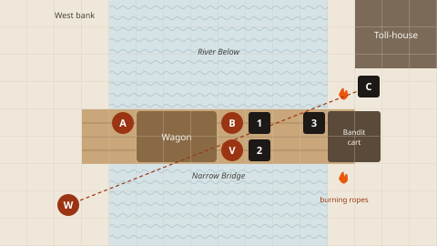

:::quote
Every round's a puzzle with a clock on it, and you get to see all the pieces before you move.
:::

In most games, tactics means finding a bonus: flank for +2, high ground for +1. Zi'Dara doesn't work like that. Before anyone moves, the GM puts everything that's coming this round on the table: what it's doing, who it's aimed at, and how hard. You can see the whole problem. The trouble is, you've got more problems than actions.

So in Zi'Dara, tactics comes down to choices, and everyone's got one action a round to make them with, or more if they've got the Aura for it. What do you answer, and who answers it? Who Defends, who intercepts, and what do you let ride? What do you ignore completely, because the stake matters more than the spear? Whose roll do you put your action into? And where do you stand when the round ends?

This chapter's about those choices. The rules themselves are in [The Core](#the-core), [Conflict](#conflict) and [The Archetypes](#archetypes), apart from movement and range, which live here. The rest of the chapter is about using them well, whether you're on a grid or playing it in your head.

## The Five Choices of a Round {#s-five-choices}

Everyone gets [one action a round](#s-actions), and your stride, a few words and dropping something are free. With that, the crew makes five choices together every round.

1.  **Answer.** Which telegraphs do you stop? An answer can stop anything, whether it's a blow, an alarm or a slammed door, but it costs an action, and if it fails, you've walked straight into it.
2.  **Defend, intercept, or let it ride.** Whatever nobody answers lands at the end of the round, and each of your tracks stops one telegraph at its Root. Who Defends, who steps in front of a friend, and who's got the tracks to let it ride? Bram's Stamina will usually stop one d4, but if three are coming at his Body and he lets them ride, at least two get through.
3.  **Press.** What do you do with the rest? Stakes, clocks, weak points, the thing the scene's actually about.
4.  **Team up and shape.** Whose roll do you put your action into? Every friend's action brings everything on their sheet that fits, and a split, so two of you on one thing is a much bigger roll than either of you alone. Then do you want one big die, several intents, or advantage?
5.  **Stand.** Where are you when the round ends? Who can reach you, who can you reach, and which friends are within your stride if you need to intercept for them?

Make all five on purpose and it's a good round. The great rounds are the ones where one action solves two problems.

If nothing's worth your action this round, **hold it**: do nothing apart from your stride, and next round you've got an extra one. There are other ways to an [extra action](#s-extra-actions) too: buy one with Aura, 3 for the first in a round and 4 for the next, or come out of hiding. An extra action can be its own roll, or go into the same roll as a combo.

## Movement and Range {#s-movement}

:::quote
You play Zi'Dara on a grid first, where 1 square is 1 unit, about five feet.
:::

-   **Stride is free.** Every character has a base **stride of 3 units**. Every round you can move your stride without spending an action, whether that's before, between or after your actions.
-   **Move action.** Spend your action to go further. Roll a Root and everything that fits how you're moving, like Vesk's Body, her first Title, *run the rooftops* and her grappling line. The number you roll is how many extra units you move. Split it, or go past 6 steps, and the dice add together. Movement's the one roll in Zi'Dara where dice add.
-   **Diagonals count as one.** It keeps things quick.
-   **Difficult ground**, like deep snow, a slick floor or a crowd, costs 2 units a square.
-   **Your sheet can change your stride.** The Stride Boon adds 2 units. A Stride Burden takes 2 away, and a *Heavy* Catch on something you've attuned takes 1, to a minimum of 0. A [Teleporter](#a-teleporter)'s stride can be a teleport of up to 10 units.
-   **Getting something out of your bag** takes your action, but putting it away is free. See [What you carry](#s-carrying).

:::rule
**No reactions, no opportunity attacks.** You can walk right past a guard and nothing lashes out at you for moving. Threats control space with their *telegraphs*, like *cut off the way to the door* or *grab whoever runs*, so you always know what moving will cost before you move. Moving doesn't get you out of a telegraph aimed at you, though. That one lands wherever you end up, and diving behind cover once it's aimed is a way of answering it, so roll for it. Only a telegraph aimed at a place, like a fire or a falling chandelier, can be walked out of.
:::

### Reach and range {#reach-and-range}

How far a bow, a thrown knife or a spell reaches is the story's call. The bands are a guide, so don't go getting a ruler out.

| Band | Grid | What reaches it |
| --- | --- | --- |
| **Close** | Next to you (1 unit) | Fists, blades, a whisper, a hand on the shoulder. |
| **Reach** | 2 units | Spears, polearms, whips: anything with *Reach*. |
| **Near** | Across a room, or down a street | Thrown and Ranged weapons: knives, slings, shortbows, pistols. Most magic. A shout. |
| **Far** | Across a town square, or a field | Longbows and crossbows: anything *Long*. Magic that goes beyond. |
| **Beyond** | Further | The story decides: a siege engine, a sniper's rifle, a working that spans the city. |

**Line of sight** comes from the story. If something solid's in the way, you can't hit through it, and neither can they. That's what cover is. It decides what's possible, and it doesn't add steps. Stand behind a wall and the archer on the roof has to telegraph at someone else, or come down.

:::example[Movement at the table]
Vesk's stride is 3. In one round she moves those 3 units for free, then spends her action to Move across the rooftops. That's her Body, her first Title, *run the rooftops*, her grappling line and *Anywhere I can throw a hook*, 12 steps, two d12s, and they add. She rolls 6 and 3, and that's 12 units in total.

Bram's stride is 3. He moves 3 units for free, then spends his action on a Move. Nothing on his sheet's about running, so it's his Body on its own, 7 steps, a d12 and a d2. He rolls 4 and 1, and that's 8 units in total. He's strong, but he's no sprinter, and his sheet says so.
:::

## Weapons and What They Let You Do {#s-weapons-tactics}

A plain weapon is just what it is. It's 1 more on any roll you use it in that it fits, so a sword's a step in a sword fight, and a dagger's still 1 more in the hand of someone with nothing else on their sheet for a fight. It lets you do what that weapon does: a sword cuts, and a spear keeps them back. An attuned weapon's an item the same way, and its awakenings do more on top: Wren's longbow is 1 more on every shot, *Long shot* is a step as well, and it's +1 on one of her dice for every Aura powering it.

Weapons also come with **properties**, free with the weapon. They're the things a weapon lets you do that bare hands can't. The full list is in [Weapon properties](#s-weapon-props). At the table they sort into four jobs:

-   **Controlling distance**: *Reach, Thrown, Ranged, Long.* You're hitting them from where they can't hit back. A spear holds a doorway, and a longbow holds a whole street.
-   **Getting through**: *Piercing, Breaker.* A crossbow bolt doesn't care about *Armoured*, whatever its multiplier, and a war hammer doesn't care about *Shield*. When everything keeping a threat going is something your weapon ignores, one win takes it out.
-   **Holding and moving**: *Grapple, Sweep, Charge.* Pin one enemy where the others can't help it, or go at a whole line at once. *Sweep* puts one die on everyone within your reach, and it's free. Unless you're an [Elementalist](#a-elementalist), it's the way to put one die on a crowd.
-   **Surprise**: *Concealed, Quick.* It's the knife nobody found, drawn without spending an action.

Some properties are costs: *Two-Handed* means no shield, and *Reload* means an action to load it again after every shot. With one action a round, that's your whole next turn, so a crossbow hits hard and then waits. The heavy hitters carry them for a reason.

## Shaping Your Dice {#s-shaping}

How you split your steps is the most important tactical decision you make every round, and it's the one new players rush. You get **one split for every action in the roll**, and going past 6 steps gives you one more on top, so 8 steps on one action can be three dice: a d6, a d6 and a d4 (the rules are in [Splitting](#s-splitting)). Before you roll, look at the defence you're rolling into.

-   **One big die** against a hard defence. A d6 isn't going to beat a d12 Warden very often, but a d12 will, sometimes. Don't split into dice that can't win.
-   **Several intents** against a soft target, or one with a lot of problems. Three d8s out of a big combo can disarm a guard captain, drop him and break his nerve in one round. He rolls his defence once for the round, and every die that beats it gets its intent. It's the same against a [multiplier](#s-tough): three dice that beat it tick three off.
-   **Advantage** when one thing has to happen. Say the sigil has to break this round. Put two dice on it, and the best one counts.
-   **Answer and act** in one roll. A fighter on 8 steps can make it a d8 to parry the blow coming at her and a d8 to strip the brute's shield, both from the same swing.
-   **A small die for a small job.** Put a d2 on keeping an eye on the door. It'll probably fail, but half the time it lands on its top face, and that's an Aura back. It costs you a split, though, so do it when the big die can spare the step.
-   **An area die when there are many of them**, if you're an [Elementalist](#a-elementalist). A d6 of fire and a d4 of area beats one d10 on one man when there are five men. It takes a split, and if the area comes up short, your Push puts +2 on it for 1 Resolve. You can always make it smaller than you rolled to keep your friends out.
-   **Watch the first roll.** A threat rolls its defence the first time it's attacked in a round, and that number stands until the round's over. If the captain's rolled a 2, everyone piles in. If he's rolled an 8, put your dice somewhere else this round.
-   **Watch for bodyguards.** The GM's people can [intercept](#s-intercept) too, for free, and she says so before you roll. Then your die has to beat the bodyguard's defence instead, so sometimes the bodyguard's the one to go at first.

:::rule
**Tags decide your targets.** A threat rolls its Challenge die once a round, the first time it's attacked, and every die aimed at it that round has to beat that one roll. Its tags never make that roll harder, unless it's *Layered*. Then it rolls a die for every tag it's got left keeping it going, and its best die is the roll that stands. What tags do decide is which win matters most. Strip *Reach* and the spear stops outranging you. Strip what keeps it going and it falls. Go after what drives it and you might not need to fight at all.
:::

## Answer, Defend, Intercept or Let It Ride {#s-answer-or-ride}

You deal with every telegraph aimed at the crew in one of four ways. Fear, lies and pressure come at your Mind, and despair, temptation and curses at your Soul, and nobody can step in front of those for you, so only three of the four work on them: answer them, Defend with something that fits, or let them ride. Shielding the crew from fear is a [Bard](#a-bard)'s job. Count the dice coming at each Root before you choose. A threat only aims one die at each of you, unless a tag like *Flurry* says it can do more, and each of your tracks stops one.

-   **Answer it** when it's big, when your track's small, or when it does something no defence can stop, like raising the alarm or slamming the door. Friends can put their actions into the same answer. If a friend's Stamina is down to a d4, answer for them. You can also answer by taking out whatever telegraphed it, or by taking away what it needs: disarm the crossbowman and his bolt never flies. See [Answering a telegraph](#s-answering).
-   **Defend** when there's more coming at a Root than one track can stop, or when you've pulled a lot onto yourself. It takes your action, and when the telegraphs land you roll a Root and everything that fits how you're defending, your armour included, on top of your tracks, so you've got more dice to stop more with. A shield won't stop a lie, though, and a cool head won't stop a spear. See [Defend](#s-defend).
-   **Intercept** when a friend can't afford the blow that's coming and you can. Step in for a friend within your stride and take as many of the dice aimed at their Body as you like, and they come at you instead. It's 1 Aura a friend and no action, so you can still act, and a [Guardian](#a-guardian) or a summon does it for free. It's only blows, so it's no use against fear. Your Stamina handles them, one die each, so if you've taken a lot, Defend as well. See [Intercept](#s-intercept).
-   **Let it ride** when there's one die coming at a Root and your track's bigger, or when you've got something better to do. At the end of the round you roll each track once, your Stamina against what's at your Body, your Confidence against your Mind and your Resolve against your Soul, and each die stops one telegraph at its Root that it beats or ties, because ties go to you. Everything else gets through. When something gets through, the GM names the cost, usually a size off that track, and you can offer another that costs about as much, or pay 2 for 1 from your other two tracks (see [When it lands](#s-defending)).

:::example[Defend, or intercept]
Two Wardens go for Isolde's Body this round, a spear thrust and a sweep, a d10 each, and her Stamina's down to a d6. She's within Bram's stride, and he's a Guardian, so he intercepts both for free, and he Defends. That's his Body, both Titles, *hold the line*, *guard one person*, *fight in a shield wall*, Guardian, his plate and his shield, 15 steps, two d12s and a d6, and his Stamina's d12 rolls with them. When it lands, the d10s come up 5 and 3, and Bram rolls 5, 3 and 2, with a 1 on his Stamina. He puts the 5 on the 5 and the 3 on the 3, and ties go to him, so neither gets through, and that's 2 Aura.

If he'd wanted his action for the Wardens instead, he could still intercept both for free and let them ride. Then it's his Stamina rolled once, so it stops one of them at most, and the other gets through to him instead of her.

Anyone else can intercept too, for 1 Aura a friend. Vesk could step in for Isolde, and with her Stamina and a Defend of her own, her Body, her second Title, *fight dirty with a knife*, her knife and her leathers, 12 steps, she'd have three dice for two blows. It'd cost her the action she wanted for the vault, though.
:::

Offering a different cost is tactics too. A size off a track is a smaller die defending that Root next time, and a size you can't spend on your archetype, and your rest at the end of the scene only brings each track back a size on a 4 or more, so a bad fight follows you into the next scene. Putting it on your shield or your plate keeps the blow off your track. It ticks a box, and when the last box goes, the piece is gone till you've spent a downtime slot, and usually a purse of gold, mending it, so it's one item less when you Defend and one box less in every fight after this one. Fine and Masterwork pieces take more blows before that happens. 2 for 1 keeps the track that's hurting where it is, for a size off each of the others. A step back on your Aspiration costs nothing in this fight, but it costs you something in the long game. The Party Goal belongs to everyone, so ask before you spend it. And a broken item is always something you carry, because attuned things can't break.

## Tags Are the Battlefield {#s-tags-battlefield}

You never need to ask how hurt something is. Read its tags instead. If a tag's got a [multiplier](#s-tough), like *Armoured ×4*, it takes that many wins, and the GM says what's left every time one ticks off.

-   **Keeps it going**: how many wins it takes, multipliers and all. Four of them makes for a long night, so look for another way.
-   **Comes at you**: what its telegraphs can do. Strip *Reach* and its spear stops outranging you. Strip *Commanding* and every one of its followers telegraphs a step smaller.
-   **Drives it**: how to end the fight without winning it. You can buy the greedy ones, let the frightened ones go, and show the loyal ones what their master really did.
-   **Vulnerable**: what makes a hit hurt more, like *Vulnerable to fire*, or *Prone* with you standing over it. Every one that fits a winning hit adds a tick, they add up, and you choose where each tick goes, so one good hit can take a knight's shield and his sword at once. See [Vulnerabilities](#s-vulnerable).
-   **Hidden**: there's always more on a boss than you can see, like a weak point or a vulnerability nobody's found yet. Spend your action on Study. It's almost never wasted.

### Openings {#openings}

An **opening** is how a big threat falls in one blow, and there are three kinds.

-   **Its weak point.** Find it, then hit it. It's the only opening that ends a Boss in one blow.
-   **It's helpless.** It's bound, asleep, or there's a knife already at its back from someone it never saw coming. Get there first and the next one of you finishes it. Against a Boss it tears two whole tags away instead, multipliers and all. That won't finish a Boss off, but it's a big step towards it.
-   **Getting around everything that keeps it going.** Shove the shielded, fortified captain off a narrow bridge into the river, and neither his shield nor his position does anything for him. Use the ground, use the right weapon, and think about what its tags actually protect it from.

### Conditions are teamwork {#s-conditions-tactics}

A condition is a win you can save for later. Once it's on, decide whether to keep the passive or spend it now.

-   **Stack the passives.** A threat that's *Blinded* and *Taunted* is up to two steps easier for everyone, on every roll those conditions fit, until they fade. Make it *Exposed* as well, and every hit on it ticks once more.
-   **Spend before it fades, or before it's broken.** The die shrinks every round. When the GM telegraphs a threat shaking one off, that's your cue. Spend it on your turn and it never gets the chance.
-   **Burning, Bleeding and Poisoned strip tags with no roll**, or tick one off a tag with a multiplier. Against a d12 defence, that's worth more than any swing.
-   **Look after each other.** A ward or a blessing costs you your action and saves a friend a hit. It goes on one friend, and if you split it, the second die can put it on another friend you can touch (see [Wards and blessings](#s-wards)). [Heal rolls](#s-healing) are a [Healer](#a-healer)'s, and they work mid-scene: each die on a 4 or more puts one of a friend's tracks up a size. Anyone can pay 1 Aura to put one of someone's tracks up a size with no roll, though that still takes your action. Every action you spend on a friend is one you're not spending on the stakes, so pick your moment.

## Stakes Beat Bodies {#s-stakes-tactics}

Most scenes have two or three stakes and a clock, and there are never enough actions to do everything. Crews coming from other games tend to kill everything first and then do the job, and in Zi'Dara that loses. While you're grinding through a Warden's fourth tag, the household wakes and the witness bleeds out.

Every round, ask yourself: *what's this scene actually about?* Put your dice there. Send one character to hold the enemies off while the others work the stakes, and let the fight be the distraction. One intercept takes the blows coming at the people doing the work, for 1 Aura a friend, and a Guardian does it for free, for every friend within his stride.

## Aura and Your Tracks {#s-aura-tactics}

Aura's what you spend, and it comes back all the time. Your [tracks](#s-tracks) are what keep you standing, and they're what your archetype's abilities cost, so every size you pay is a size you're not defending with.

-   **Spend your Aura.** It refills every scene, so a full tank at the end of a scene is Aura you never used. Spend it where it changes the dice: the ground or a threat's tag brought in, or something on your sheet you make a case for, can turn a d12 and a d6 into a d12 and a d10, and that's often enough.
-   **Spend it while you're acting.** On your own turn it can go past your maximum, and it drops back to your maximum when you're done, so spend it first: 3 buys an extra action, 4 the next one, and anything you bring in is a step.
-   **Power it when it counts.** Powering a passive awakening takes the Aura off your maximum as well as off what you've got, so you're playing on a smaller maximum for the rest of the scene. Power it when its +1s will count for the rest of the scene, like Vesk's line before a climb.
-   **Keep one for a friend.** [Intercepting](#s-intercept) costs 1 Aura a friend and no action, so an Aura you've kept back can move a blow off a friend whose Stamina is down to a d4 and onto you.
-   **Farm it, and share it.** Every die that wins and every top face is 1 Aura back, and small dice land on their top face more often. When you've got a split to spare, peel off a d2 with a small intent. Aura that comes in while you're not acting, like off your defence, stops at your maximum, and you can give the rest to a friend in the scene.
-   **Let trouble bite.** Let a Catch bite as often as you like, Scars included, and take 1 Aura each time. It has to bring real trouble every time, and you don't even need a Catch on your sheet: bring real trouble on yourself in the story and take 1 Aura. Do it when the scene can stand a bit more trouble.
-   **Other ways back.** The Beat a threat and In your element Boons bring Aura back. And when a great setup doesn't land (you planned it, it was cool, and the dice said no), the GM can give you 1 Aura.
-   **Ties matter.** A tie on the roll that ends the fight is worth an Aura, every time.
-   **Your tracks pay for the big things.** An ability costs 1 from its archetype's home track, or 2 from your other two, and it stacks: Bram's *Stand firm* makes the next two hits that get through to him do nothing, and paying again makes it two more. Push is +2 on your mechanic once you've rolled, so you only pay when you can see it'll make the difference. Rolling again costs 1 Resolve, and it's best when the threat rolled low, because its dice stay where they landed. Paying never takes a track below d2, so nobody Blazes on purpose (see [Abilities](#s-abilities)).
-   **Pay from the track that isn't being hit.** Every size you pay off your Stamina is a smaller die against the next blow. When your home track's getting low and the fight's at your Body, pay 2 for 1 from the other two instead. Your tracks come back at the end of every scene, a size on a 4 or more, and a big bite from a Catch or a hostile thread puts your Resolve up a size, and so does straining a bond thread (see [Bonds and threads](#s-bonds)).

### Mind and Soul {#s-confidence-tactics}

Your Confidence and your Resolve are [tracks](#s-tracks) like your Stamina, and the GM goes after them the same way: fear, lies and pressure at your Mind, and despair, temptation and curses at your Soul. A crew built for blows isn't always built for words.

-   **Nobody steps in front of them.** Intercepting only takes blows at a friend's Body, so you can't share these out. Answer them, Defend with something that fits, like a cool head or a prayer you trust, or let them ride.
-   **Wear armour there too.** Court clothes at court, a uniform in the barracks, or a holy symbol or a ward stitched into your coat each take a hit at their Root, the way plate does at your Body (see [Armour](#s-armour)).
-   **Count the dice at each Root.** A blow and a lie at the same time are two tracks and two rolls. Two lies at once are one roll, so one of them's getting through unless you do something about it.
-   **Take a breath.** Spend your action and your Confidence comes up a size, as far as d6. It's no use on a d8, and a good trade on a d2.
-   **Finish high.** When the scene ends you rest: each track below d12 rolls, and a 4 or more puts it up a size. A track on d2 waits for downtime, so don't let a cheap taunt in the last round take you there (see [Healing](#s-healing)).
-   **A Bard shields the crew.** A [Bard](#a-bard)'s song can Defend everyone who can hear it against fear, lies and pressure, split as often as the Bard likes, and each die stops one telegraph. Whatever it misses still has to get past each friend's own Confidence. Or the song lifts every one of them, a 4 or more putting their Confidence up a size, as far as d10.

:::example[A roar and a sneer]
The brute roars at Bram's Mind, a d8, and the captain sneers at him too, a d6, both at his Mind. Bram lets them ride, so his Confidence rolls once and comes up 7. It stops the roar's 6, and that's 1 Aura, but the sneer's 3 gets through, because one die stops one. His Confidence is a d10. He could have offered his plate, but plate's no good against a sneer.

Across the room, Ash has a curse at her Soul from the hedge-witch, a d8, and the brute's dog at her Body, a d10. They're different tracks, so each gets its own roll. Her Resolve stops the curse, but her Stamina's down to a d4 after the dog's first bite, and it misses again. She pays 2 for 1, a size of Confidence and a size of Resolve, and her Stamina stays on d4 instead of dropping to d2.
:::

## Roles Come From Your Sheet {#s-roles}

Every crew finds its roles, and every character plays a few. Each of your [archetypes](#s-how-archetypes) gives you something only it can do, and your biggest Roots and what's on your sheet show what you do all the time, so look at both and you'll see your roles.

-   **The wall.** A big Body, a Title that holds the line, and Body armour. You intercept, Defend and hold the narrow place, and if you're a [Guardian](#a-guardian), you intercept for free, for every friend within your stride. That's Bram.
-   **The blade.** A big Root and a fighting Title. You strip tags, take openings and end things. A [Warrior](#a-warrior)'s dice explode in a fight, and a [Bloodsworn](#a-bloodsworn) gets 3 more steps for every size their Stamina drops. Wren's shot from cover is her Body, both Titles, Hunter twice, her longbow and *Long shot*, 12 steps, two d12s.
-   **The hunter.** You pick the target, and the crew piles in. A [Hunter](#a-hunter) marks it, and everyone who goes at it rolls the Mark die as well, as one more die against it. When it falls, the Mark jumps to another creature you can see. That's Wren.
-   **The opener.** Your split goes on a second intent: disarm, trip, blind or expose. You put conditions on threats for the blade to spend, and *Prone* and *Exposed* are [vulnerabilities](#s-vulnerable), so every hit they fit ticks once more.
-   **The keeper.** Wards and blessings, on one friend or two with a split. You put conditions on friends and keep their tracks up, and if you're a [Healer](#a-healer), you heal them in the middle of a scene. That's what Isolde's *draw a ward the dead can't cross* is for. She's an [Oracle](#a-oracle) as well, so she can roll her foresight before anything lands, then swap a low number into a threat's die or a high one into a friend's.
-   **The eye.** A big Mind, and permissions like *scout ahead of an army*, *find what I need in any library* or *read a room in a glance*. You find weak points and hidden drives, and tell everyone else where to aim. If you're a [Scholar](#a-scholar), a Study you win can make something true instead, and the whole crew can use it this scene.
-   **The voice.** A big Mind or Soul, and permissions like *make a lie sound like old news* or *talk my way past a door*. You talk threats down, turn them, buy them, and end fights that were never worth having. If you're a [Face](#a-face), you put influence on a threat, and each of its dice your best influence die beats does what you say instead. That's Dorrie.
-   **The leader.** Only a [Leader](#a-leader) leads. You build an order or a rallying song from a Root and everything that fits, then hand its steps out to friends who can hear or see you, for their own rolls this round, and those steps don't have to fit. Bram barks his orders with his Soul, his second Title, *bark an order that gets obeyed* and Leader. A [Bard](#a-bard)'s song works on nerve instead: it lifts every friend who can hear it a size of Confidence on a 4 or more, as far as d10, or Defends all of them against fear.
-   **The runner.** A big Body, and permissions like *move unseen* or *run the rooftops*. You work the stakes and the clocks while everyone else is busy. Coming out of hiding gets anyone an extra action, and if you're a [Shadow](#a-shadow), the dice you hid with go in your shadow pool for later. That's Vesk.
-   **The storm.** You put one roll on the whole room, with an [Elementalist](#a-elementalist)'s area, which is free, or with a *Sweep* weapon. That's Ash.

The other archetypes bring jobs of their own, like a Maker's tags or a Summoner's souls. If you're stuck, the [Title ideas](#s-title-ideas) say which archetypes suit each idea.

## A Round on the Grid {#s-grid-example}

Bram, Vesk, Ash and Wren are taking a wagon over a toll bridge, and the bandits who hold the bridge have other ideas. That's four players, so the GM's got about 40 steps a round to telegraph with, 10 for each of them.

*The toll bridge, round one. One square is one unit. B Bram, V Vesk, A Ash, W Wren on a rock on the west bank, her line of fire to the captain dashed. 1–3 bandits. C the toll captain in the toll-house doorway. The bandits' cart blocks the east end of the bridge, and the anchor ropes behind it are burning.*

:::rule
**The scene.**

**Stake:** *Get the wagon across*, Challenge 3. In the way: *Blocked*.

**Scene clock:** *The bridge burns*, d8. When it runs out, the bridge falls.

**The toll captain**, Challenge 4. Comes at you: *At Range* (a crossbow), *Commanding*. Keeps him going: *Shield*, *Fortified* (the doorway). Drives him: one hidden tag.

**Three bandits**, Challenge 2. Comes at you: *Belligerent*. Drives them: *One of Many*. Nothing keeps them going, so it's one good win each.

**Ground:** *Narrow Bridge* (two abreast, no more), *River Below*.
:::

:::example
**GM:** The captain levels his crossbow at Ash's Body, a d8. Bandits one and two hack at Bram's Body, a d6 each. That's a step bigger because the captain's watching, and *Commanding* says so. Bandit three winds up to hurl a torch into the wagon's straw, a d6 at the stake, and it's got one answer: if it lands, the wagon's on fire. And the fire's running along the ropes, so *The bridge burns* will tick at the end of the round.
:::

So that's 4 + 3 + 3 + 3 = 13 steps out of about 40, and the GM holds the rest back. It's round one, and the bandits think they've got this.

The crew looks at the map. There are four problems, and one action each to spend on them: the bolt at Ash, two blades at Bram, a torch at the wagon, and the fire. And there's one opportunity nobody's said out loud yet: the river.

**Wren** goes first, from her rock.

:::example
**Wren:** That's my Body, both Titles, Hunter twice, my longbow and *Long shot*, 12 steps, two d12s. The captain's 11 squares away across the water, which is *Far*, and a longbow reaches Far. I'm shooting the crossbow out of his hands, with both dice.

**GM:** Nobody's gone at him yet this round, so roll his d8 with yours.

**Wren:** 7 and 1, and his d8's a 5. **GM:** The crossbow spins off the toll-house porch into the water, and his bolt at Ash never flies.
:::

That 5 is the captain's defence for the rest of the round, so anyone else who goes at him before it ends has to beat it. Wren's answered the bolt without rolling an answer. She took away what it needed instead.

**Bram** has two blades coming at him.

:::example
**Bram:** Two d6s at my Body, and if I let them ride, my Stamina only stops one of them. I could Defend, but I'd rather put them in the river. My Body, both Titles, *hold the line*, my hammer and *Ring the bell* are 12 steps, and I'll bring in *River Below* for 1 Aura, so that's 13, two d12s and a d2: one d12 to knock bandit one over the rail, and the other and the d2 for bandit two.

**GM:** Neither's been attacked yet, so roll both their d4s.

**Bram:** 7 and 2 on the d12s, and 1 on the d2. Their d4s are 2 and 3. **GM:** Bandit one goes over the rail. Splash. His blade goes with him. Bandit two ducks under the hammer, and he's still coming.
:::

**Ash** isn't being shot at any more, so she turns to the torch.

:::example
**Ash:** I'll step up onto the wagon with my stride, so I can see over Bram and Vesk. I want them off the bridge more than I want them burnt, so it's my Soul, my first Title, *make a threat stick* and Elementalist, 11 steps, a d12 and a d10. The d10's my burst. I'm an Elementalist, so it's free.

**GM:** Bandit three hasn't been attacked yet, so roll his d4. Bandit two's still on the 3 he rolled against Bram.

**Ash:** My d10's a 3. Three squares would catch Bram, Vesk and the wagon, though, so I'll make it 1, on the planks between bandits two and three. My d12 is a 3.

**GM:** Bandit three rolls a 1.

**Ash:** Three's done. Two's a tie, and that goes to him unless I pay an Aura. I'll leave it. He's got Bram in front of him. **GM:** Bandit three drops his torch into the river and goes in after it.
:::

Ash's win is 1 Aura, so she's on 8 while she's acting. She powers *Fire without a word* with 1 before she's done, which takes it off her maximum too, so she finishes on 6, and every roll she throws fire with this scene has +1 on one die.

**Vesk** has the best idea at the table.

:::example
**Vesk:** The captain's *Fortified* because he's in a doorway looking at the bridge, and his shield's pointing that way too. So I go over the side on my grappling line, along the underside of the bridge, and up behind him.

**GM:** That's 8 squares the long way round.

**Vesk:** My stride's 3, so I need a Move for the rest. That's my Body, my first Title, *move unseen*, Shadow twice, my line and *Anywhere I can throw a hook*, 14 steps, two d12s and a d4, and a Move adds them up. ...5, 2 and 1. That's 11 with my stride, so I'm behind him with room to spare. **GM:** You're crouched on the toll-house step at his back, and he's got no idea you're there.
:::

**End of Round 1.** The bolt, the torch and bandit one's blade all went with whatever sent them. Bandit two's d6 is the only die left coming at Bram, and he lets it ride: his Stamina comes up 5 against the bandit's 4, so nothing lands, and that's 1 Aura back for the one he spent on the river. Nobody worked the fire, so *The bridge burns* steps down to a d6.

### Round 2: The opening {#round-2-the-opening}

:::example
**GM:** The captain grabs the rope of the toll bell to call the rest of the gang off the far bank. That's a d8 at the stake, and it's got one answer: if it lands, there's a new tag in the way, *Reinforcements*. Bandit two, alone on the bridge now, hacks at Bram's Body again, a d6.
:::

That's 4 + 3 = 7 steps. The GM's still got about 40, but there's nothing left worth spending them on, which means you're winning.

And Vesk's right behind the captain. His shield and his doorway both face the bridge, so she's around everything that keeps him going, and that's an opening. The next win against him takes him out, whatever he's got left. Her Body, her second Title, *fight dirty with a knife* and her knife are 11 steps, a d12 and a d10, against his d8. That's a good chance, but it's the roll that ends the fight, so Wren makes sure of it.

:::example
**Wren:** I'm in. I've got an arrow on the string, aimed at his face. "Don't." That's my action in Vesk's roll, so both my Titles, Hunter twice, my longbow and *Long shot* go in with it.

**Vesk:** And my knife's at his back. That's 11 of mine, and Wren's 6 make it 17 between us, two d12s and a d10. They all go on "yield, now", so it's advantage.

**GM:** Roll his d8.

**Vesk:** His d8's a 6. I've got 8 and 3 on the d12s and 10 on the d10, and that's the d10's top face. **GM:** He yields. Sweating, he tells you the toll money's in the strongbox upstairs, and it can all be yours. That's his hidden tag: *Can Be Bought*.
:::

Two dice won, and one was a top face, so that's 3 Aura for Vesk, because she rolled. She's on 10 while she's acting, but there's nothing left worth an extra action, so what's over her 7 is gone when she's done. Bandit two sees his captain on his knees and remembers he's *One of Many*, so he jumps. Nobody rolls for it, because the story's already decided it, and his blade goes with him.

That leaves the cart. Bram walks up to it with his stride and tips it in the river. That's his Body and *lift what two men can't*, 8 steps, and he brings in *River Below* again for 1 Aura, so it's 9, a d12 and a d6. He rolls 6 against the stake's d6, which comes up 2. *Blocked* is gone, there's nothing else in the way, and Ash takes the reins and drives the wagon across.

**Two rounds.** Nobody on the crew got hurt, so every track comes off the bridge on d12. The captain had two tags keeping him going, and he fell to one win because Vesk got around both of them and Wren made it close to a sure thing. Ash's burst cost her no Aura, and making it smaller kept Bram and Vesk out of it. Nobody spent an action on the fire, either: it needed four rounds to drop the bridge, and the crew only needed two. And the river did more damage than any weapon.

## Playing Without a Grid {#s-theatre}

You don't need a map. Use the bands instead of squares.

-   **Close, Reach and Near** are within your free stride of each other, so moving between them costs nothing.
-   **Far** takes a Move action to cross.
-   **Beyond** takes more than one round.

When it matters where someone is, like who's in the doorway or who can reach the lever, say it out loud and the GM writes it on a card in the middle of the table. A rough sketch on scrap paper counts as a grid too.

## Five Mistakes Every New Crew Makes {#s-tactics-mistakes}

1.  **Killing everything first.** The scene has stakes, so work them.
2.  **Splitting into dice that can't win.** A d6 and a d4 against a d10 are two long shots. Look at the defence before you split.
3.  **Answering everything.** A failed answer lands with no defence roll at all, so let a small one ride when your track's big. Count them first, though: one track stops one at its Root, so when three are coming at your Body, Defend.
4.  **Never studying.** Every boss has something hidden, like a weak point or a vulnerability, and it's usually the way to win.
5.  **Sitting on a full tank.** Aura refills every scene, and anything past your maximum is gone when your turn ends, so spend it.
